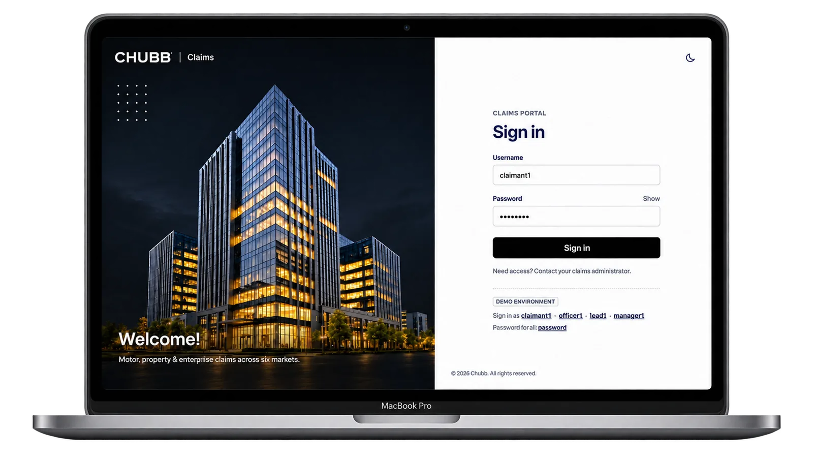

# Chubb APAC Claims Platform

A claims platform for motor and property claims across six APAC markets: one Angular app for claimants and claims staff, backed by two Spring Boot services that talk over REST and Kafka.



[](https://github.com/heikaliskandar/chubb-claims-platform/actions/workflows/ci.yml)


Every library, its version, licence and why it was chosen: **[docs/tech-stack.md](docs/tech-stack.md)**. All open source, with no commercial UI library.

| Who | Can |
|---|---|
| **Claimants** | Report an incident, track the claim, answer information requests, receive the decision |
| **Claims officers** | Pick up claims from the queue, review, request information, assess, approve, reject, settle |
| **Team leads** | Everything an officer can, plus approve referrals above an officer's limit and see the team's performance |
| **Managers** | Outstanding liability exposure per currency, workload and performance across teams |

> Take-home assessment. The brief is in [docs/ASSESSMENT_BRIEF.md](docs/ASSESSMENT_BRIEF.md). How AI was used is logged in [AI_JOURNAL.md](AI_JOURNAL.md).

## Quick start

```bash
docker compose up --build -d
```

Open **http://localhost:4200** and sign in as `claimant1`, `officer1`, `lead1` or `manager1`. The password for all of them is `password`.

**Without installing anything:** open the repo in **GitHub Codespaces** (*Code → Codespaces → Create*); the app starts by itself. To host it for others for free, see **[docs/deploy.md](docs/deploy.md)**.

## Documentation

| | |
|---|---|
| **[User flows](docs/user-flows.md)** | Each user type step by step, with diagrams, the demo data and a ten-minute walkthrough |
| **[Features](docs/README.md#features)** | [Submission and tracking](docs/features/claim-submission-and-tracking.md) · [Claim handling](docs/features/claim-handling.md) · [Approvals](docs/features/approvals.md) · [Supporting documents](docs/features/supporting-documents.md) · [Dashboards](docs/features/dashboards-and-insights.md) · [Employees](docs/features/employees-and-hierarchy.md) · [Events](docs/features/events-and-messaging.md) · [Security and privacy](docs/features/security-and-privacy.md) · [Data model](docs/features/data-model.md) · [Frontend](docs/features/frontend.md) · [Testing](docs/features/testing.md) |
| **[Architecture](docs/architecture.md)** | Services, REST vs Kafka, reliability, scaling |
| **[API reference](docs/api/README.md)** | Live docs at **http://localhost:4200/api/docs** for both services, generated from the code, plus the committed OpenAPI contract |
| **[Decisions](docs/README.md#decisions-adrs)** | Eight architecture decision records |
| **[Tech stack](docs/tech-stack.md)** | Frameworks, libraries, versions and licences |
| **[Deployment](docs/deploy.md)** | Free hosting: GitHub Codespaces in one click, or an Oracle Cloud Always Free VM with HTTPS via one script |

## How the brief is covered

Step-by-step flows for every user type, with diagrams, the demo data and a ten-minute walkthrough: **[docs/user-flows.md](docs/user-flows.md)**.

| Brief requirement | Where it lives |
|---|---|
| Claimants report an incident ([doc](docs/features/claim-submission-and-tracking.md)) | **Claims → New claim** (`POST /claims`, with `Idempotency-Key` so a double submit can't create two claims) |
| Claimants track their claim | **Claims → My claims / History**; claim page with status, "waiting on", next step and full activity timeline; refreshes every 10 s |
| Claimants provide information when asked ([documents](docs/features/supporting-documents.md)) | "We need more information" banner on My claims; **Respond** on the claim page; **supporting documents** (photos, police report, quotes) attached when reporting or at any time while the claim is open |
| Claimants receive decisions | Decision card with outcome, amount and reason; event-driven notification stub in insights-service |
| Staff pick up incoming claims ([doc](docs/features/claim-handling.md)) | **Claims → Queue** → **Assign to me** (optimistic locking stops two officers taking the same claim) |
| Staff review and assess | **Start review**, **Request info**, **Assess** (sets the reserve; every re-assessment kept) |
| Staff progress to settlement or rejection ([approvals](docs/features/approvals.md)) | **Approve / Reject / Mark settled**; approvals above the officer's per-currency limit go to **Approvals** for someone above them (four-eyes) |
| Staff see team workload and performance ([doc](docs/features/dashboards-and-insights.md)) | **Team → Performance** (open claims by officer and status, decisions, average hours to decision) and **Team → People** (reporting line, profiles) |
| Managers see outstanding claims and liability exposure | **Overview** dashboard: reserve per currency, by market and type, workload chart |
| Same Angular app for every user type ([doc](docs/features/frontend.md)) | One app; menus, pages and buttons adapt to role, position and `allowedActions` |
| REST and Kafka, with a reason for each ([doc](docs/features/events-and-messaging.md)) | REST for anything a user waits on; Kafka (transactional outbox, idempotent consumer, DLT) for facts other parts of the system react to. See [ADR 0002](docs/adr/0002-rest-vs-kafka.md) |
| Async processing across both tiers | Outbox → Kafka → read model; the UI polls and shows "Updated hh:mm:ss" on dashboards |

**Beyond the brief:** delegated approval authority per position and currency, four-eyes referrals with an approvals inbox, a reporting-line hierarchy that controls who sees which claims and people, employee profiles, light and dark themes, a responsive layout, RFC 7807 errors, OpenAPI docs, 171 unit and web tests plus Testcontainers integration tests against real PostgreSQL and Kafka, security headers with a strict Content Security Policy, 69 Playwright end-to-end tests mapped to the brief, and Lighthouse 100 for accessibility and best practices on every signed-in page.

## Architecture at a glance

| Component | Role | Port |
|---|---|---|
| `claims-service` | System of record. REST API for all writes and claim reads. Publishes claim events to Kafka through a transactional outbox. | 8081 |
| `insights-service` | Consumes claim events and keeps a read model for the workload, performance and exposure dashboards. | 8082 |
| PostgreSQL 17 | One database and login per service (`claims`, `insights`). | 5432 |
| Kafka 4.4 (KRaft) | Topic `claims.claim-events.v1`, keyed by claim ID. | 9094 (host) |
| Kafka UI | Browse topics and messages. | 8090 |
| `frontend` | Angular 22 app for all roles, with its own small component set (no paid UI library), light and dark themes and a responsive sidebar layout. Served by nginx, which also proxies `/api` to the services. | 4200 |

**REST** is used when a user is waiting for an answer. **Kafka** carries facts that have already happened. Details, diagrams and scaling notes: [docs/architecture.md](docs/architecture.md). Key decisions: [docs/adr](docs/adr). Schema: [data model](docs/features/data-model.md).

## Prerequisites

- Docker Desktop (with Compose v2). This is all you need to run the stack.
- JDK 21 to run the services or tests outside Docker.
- Node.js 22+ to run the frontend outside Docker.

## Running locally

```bash
docker compose up --build
```

| Check | URL |
|---|---|
| **Web app** | **http://localhost:4200** |
| claims-service health | http://localhost:8081/actuator/health |
| insights-service health | http://localhost:8082/actuator/health |
| **API docs (both services, try it out)** | **http://localhost:4200/api/docs** |
| Kafka UI | http://localhost:8090 |

Each health endpoint should report `"status":"UP"`. Component details (database, disk) are only shown to authenticated callers.

The passwords in `docker-compose.yml` are **dev-only defaults**. Override them with environment variables or a git-ignored `.env` file.

To run one service from your IDE or with Maven (with Postgres started by Compose):

```bash
docker compose up -d postgres
cd services/claims-service
DB_PASSWORD=claims_dev_pw DEMO_USER_PASSWORD=password ./mvnw spring-boot:run
```

Frontend development server (with the backend running in Compose), proxying `/api` to ports 8081 and 8082:

```bash
cd frontend && npm install && npm start    # http://localhost:4200
```

To reset the database (the init script only runs on an empty volume): `docker compose down -v`.

## Demo users

HTTP Basic, all with the password `password` (set with `DEMO_USER_PASSWORD`). Production would use OIDC/SSO (e.g. Azure AD or Keycloak) instead.

A fresh stack is seeded with **nine claims, one at each stage of the lifecycle** across all six markets, so every screen has something to act on. The list, and what to try with each, is in [docs/user-flows.md](docs/user-flows.md#demo-data-one-claim-per-stage). To return to that state: `docker compose down -v && docker compose up --build -d`. To start with **no claims at all** (empty for claimants and staff; employees and reporting lines are kept), put `DEMO_CLAIMS_ENABLED=false` in a local `.env` file before the first start.

| User | Name | Role | Position | Team | Reports to |
|---|---|---|---|---|---|
| `claimant1`, `claimant2` | — | CLAIMANT | — | — | — |
| `manager1` | Grace Tan | MANAGER | Claims Manager (L4) | Claims Leadership | — |
| `lead1` | Arjun Mehta | OFFICER | Team Lead (L3) | Motor Claims | manager1 |
| `lead2` | Siti Rahman | OFFICER | Team Lead (L3) | Property Claims | manager1 |
| `officer1` | Daniel Lim | OFFICER | Claims Officer (L1) | Motor Claims | lead1 |
| `officer2` | Mei Ling Wong | OFFICER | Senior Claims Officer (L2) | Motor Claims | lead1 |
| `officer3` | Rizal Santos | OFFICER | Claims Officer (L1) | Property Claims | lead2 |

Logins (username, password, role) come from configuration. Positions, teams and the reporting line come from the **employee directory** (`employee` table), the way an identity provider would sync them from HR.

With `DEMO_DATA_ENABLED=true` (the Compose default), `CLM-SG-2026-000006`, for SGD 78,000 recommended by officer1, is waiting for approval: try approving it as `officer1` (blocked by the four-eyes rule), `lead2` (not above officer1 in the reporting line) and `lead1` (allowed).

## Approval authority

Each position can approve up to a limit **per currency** (`app.authority.limits`), so no FX conversion is ever needed:

| Position | SGD | MYR | HKD | THB | IDR | PHP |
|---|---|---|---|---|---|---|
| Claims Officer | 10k | 30k | 60k | 250k | 100M | 400k |
| Senior Claims Officer | 50k | 150k | 300k | 1.25M | 500M | 2M |
| Team Lead | 250k | 750k | 1.5M | 6M | 2.5B | 10M |
| Claims Manager | unlimited | | | | | |

```
UNDER_REVIEW ── assigned officer approves amount X (POST /decision)
   ├─ X within the officer's limit → APPROVED
   └─ X above the limit           → PENDING_APPROVAL (referred)
         POST /approval by someone above the officer in the reporting line whose limit covers X:
         ├─ APPROVE → APPROVED     ├─ RETURN (comment) → UNDER_REVIEW     └─ REJECT (comment) → REJECTED
```

Every claim response includes `allowedActions` for the current user, `waitingOn` (CLAIMS_TEAM, ASSIGNED_OFFICER, CLAIMANT, APPROVER or NOBODY) and a plain-language `nextStep`, so the frontend never re-implements the rules.

## API

**Live, interactive docs for both services: http://localhost:4200/api/docs** (click **Authorize** and sign in as a demo user). They are generated from the code, so they always match it, and every change to the API also shows up as a diff in the committed contract under [docs/api](docs/api/README.md). On by default only in the Compose stack (`API_DOCS_ENABLED=true`).

| Method | Path | Role |
|---|---|---|
| POST | `/api/v1/claims` (optional `Idempotency-Key` header) | CLAIMANT |
| GET | `/api/v1/claims?status=&assignedTo=&closed=&page=&size=` | OFFICER, MANAGER (unassigned + own reporting line) |
| GET | `/api/v1/claims/approvals?view=TO_REVIEW\|DECIDED\|MY_REFERRALS` | OFFICER, MANAGER |
| GET | `/api/v1/claims/mine?closed=` | CLAIMANT |
| GET | `/api/v1/claims/{id}` | any (claimants: own claims only) |
| POST | `/api/v1/claims/{id}/assignment` | OFFICER |
| POST | `/api/v1/claims/{id}/review` | OFFICER (assigned) |
| POST | `/api/v1/claims/{id}/information-requests` | OFFICER (assigned) |
| POST | `/api/v1/claims/{id}/information-requests/{requestId}/response` | CLAIMANT (owner) |
| POST | `/api/v1/claims/{id}/assessment` | OFFICER (assigned) |
| POST | `/api/v1/claims/{id}/decision` | OFFICER (assigned) |
| POST | `/api/v1/claims/{id}/approval` | OFFICER, MANAGER (above the recommender, enough authority) |
| POST | `/api/v1/claims/{id}/settlement` | OFFICER (assigned) |
| GET | `/api/v1/claims/{id}/documents` | anyone who can see the claim |
| POST | `/api/v1/claims/{id}/documents` (multipart `file`, `category`) | claimant (owner) or assigned officer, while the claim is open |
| GET | `/api/v1/claims/{id}/documents/{documentId}/content` | anyone who can see the claim |
| GET | `/api/v1/me` | any |
| GET | `/api/v1/employees?q=&page=&size=` | OFFICER, MANAGER (yourself and everyone below you) |
| GET | `/api/v1/employees/me` | OFFICER, MANAGER |
| PATCH | `/api/v1/employees/me` (phone, office) | OFFICER, MANAGER |
| GET | `/api/v1/employees/{username}` | OFFICER, MANAGER (only people below you; others return 404) |

**Who sees what.** Staff see unassigned claims plus claims assigned to themselves or anyone below them in the reporting line; the same rule hides people above or beside you in the directory. Your own profile shows your direct manager's name only.

insights-service (same docs portal, *Insights service*). Read-only and eventually consistent: each report carries `asOf`, the time of the latest event applied.

| Method | Path | Role |
|---|---|---|
| GET | `/api/v1/insights/workload` | OFFICER, MANAGER |
| GET | `/api/v1/insights/performance` | OFFICER, MANAGER |
| GET | `/api/v1/insights/exposure` | MANAGER |

Officer teams are configured in `app.officer-teams` in insights-service.

Errors are RFC 7807 Problem Details: 400 validation, 401 unauthenticated, 403 not allowed, 404 not found (also returned for another claimant's claim), 409 invalid status or concurrent update, 422 business rule violated.

```bash
curl -u claimant1:password -H "Content-Type: application/json" -H "Idempotency-Key: $(uuidgen)" \
  -d '{"policyNumber":"POL-SG-1001","market":"SG","claimType":"MOTOR","incidentDate":"2026-11-01",
       "incidentDescription":"Rear-ended at a traffic light","claimedAmount":3200.00}' \
  http://localhost:8081/api/v1/claims

curl -u officer1:password "http://localhost:8081/api/v1/claims?status=SUBMITTED"
curl -u officer1:password -X POST http://localhost:8081/api/v1/claims/{id}/assignment
```

## Tests

```bash
cd services/claims-service && ./mvnw test      # 158 unit + web-layer tests, no Docker needed
cd services/insights-service && ./mvnw test    # 13 unit + web-layer tests
./mvnw verify                                  # adds the Testcontainers integration tests (needs Docker)
cd frontend && npm test -- --watch=false       # 16 frontend unit tests (Vitest)
cd e2e && npm ci && npx playwright test        # 69 end-to-end tests against the running stack
```

Every push runs all of these in **GitHub Actions** ([.github/workflows/ci.yml](.github/workflows/ci.yml)): both services' unit and Testcontainers suites, frontend formatting, unit tests and production build, then the full stack in Docker Compose with the Playwright suite. On failure the Playwright report, traces and service logs are uploaded.

| Area | What is tested |
|---|---|
| State machine | All 64 status pairs against an independently written table (`ClaimStatusTest`) |
| Business rules | Money validation, assignment, info requests, assessment, approval limits, referral, four-eyes, allowed actions (`ClaimTest`, `AuthorityLimitsTest`) |
| API and security | Authentication, roles, validation errors, Problem Details mapping, idempotent submit (`ClaimControllerTest`, `DashboardControllerTest`) |
| Money and reporting | Per-currency totals that are never mixed, weighted team averages, workload grouping (`ExposureReportTest`, `PerformanceReportTest`, `WorkloadReportTest`) |
| Frontend unit (Vitest) | Session kept per tab and cleared on sign-out, error interceptor (401 sign-out, Problem Details toasts), the tab re-select regression, label formatting |
| End to end (Playwright, [e2e/](e2e/README.md)) | Every brief requirement driven through the browser as claimant, officer, team lead and manager, on desktop and mobile; Kafka read model updates; four-eyes approvals; security headers; WCAG 2.1 AA with axe-core |
| Integration (Testcontainers, PostgreSQL 17 + Kafka 4.4) | Flyway schema matches the entities; claim and outbox event commit together; a failed command writes no event; events reach Kafka in order; optimistic-lock conflict; duplicate and stale events are ignored; poison messages go to the DLT |

## Security and performance

| Area | What is in place |
|---|---|
| Authentication | HTTP Basic over a stateless API. The session is kept in `sessionStorage`: it survives a reload but is scoped to one tab and cleared when the tab closes or the user signs out. Nothing goes to `localStorage` or cookies, and the strict CSP below limits what any injected script could do. Production replaces this with OIDC and an `HttpOnly` cookie ([path to production](#path-to-production)). |
| Authorization | Role and position checks on every endpoint (`@PreAuthorize`); reporting-line scoping returns 404, not 403, for claims and people outside your scope, so their existence isn't leaked. |
| Browser hardening | nginx sends a strict Content Security Policy (no inline scripts except two pinned by SHA-256 hash; no third-party scripts), `X-Frame-Options: DENY`, `nosniff`, `Referrer-Policy`, `Permissions-Policy` and `Cross-Origin-Opener-Policy`. Server version is hidden. |
| Brute force | Five consecutive failed sign-ins lock the account for 15 minutes in both services, and the lockout is audited. |
| Personal data (PDPA) | Kafka events and the insights read model hold no personal data; every read of a claim or colleague profile is written to a dedicated `AUDIT` log with actor, role and record ID, never the data itself. See [ADR 0007](docs/adr/0007-personal-data-protection.md). |
| Database integrity | CHECK constraints on every status, market, currency and position code, and on the completeness of decisions, referrals and answers. |
| Errors | RFC 7807 Problem Details with no stack traces or SQL in responses. Health details and API docs are hidden by default. |
| Caching | Hashed JS/CSS bundles are cached for a year as `immutable`; `index.html` is `no-cache`, so a deploy is picked up on the next load. API responses are `no-store` (Spring Security default). Static assets are gzip-compressed. |
| Bundle | 311 kB initial (85 kB over the wire); every feature route is lazy-loaded. |
| Lighthouse | Login page: Accessibility 100, Best Practices 100. All 11 signed-in pages checked (manager, lead and claimant): Accessibility 100, Best Practices 100. SEO is deliberately low: `robots.txt` blocks indexing because this is an internal application. |

## Path to production

Deliberately not built, to keep the scope honest. The design already leaves room for each:

| Topic | Production approach |
|---|---|
| Sessions | OIDC (Entra ID, Okta or Keycloak) with a backend-for-frontend: the browser holds only an `HttpOnly`, `Secure`, `SameSite=Lax` session cookie, tokens stay server-side, CSRF protection is switched back on. This replaces HTTP Basic and the demo user list. |
| Claimant onboarding | Claimants are not "signed up"; they are matched to a policy (policy number plus date of birth, or a one-time code to the email on the policy), then linked to an identity in the identity provider. |
| Staff accounts | Provisioned from HR (joiners, movers, leavers) via SCIM into the identity provider. Positions and reporting lines sync from the HR system. |
| Administration | No single super-user. An admin role manages positions and approval limits, every change is audited, and limit changes need a second approver, the same four-eyes rule used for claims. |
| Email and SMS | A notification service consumes the existing `claims.claim-events.v1` topic (the insights-service stub already shows where), renders templates per market and language, sends through SES or SendGrid, and retries through a DLT. |
| Push and live updates | Web Push or FCM from the same notification service; Server-Sent Events in the app instead of polling. |

## Assumptions

1. The six markets are SG, MY, HK, TH, ID and PH, with currencies SGD, MYR, HKD, THB, IDR and PHP.
2. Policy numbers are not validated (no policy admin system integration).
3. Supporting documents are PDF, JPEG, PNG or WebP, up to 10 MB each and 20 per claim, and cannot be deleted once added.
4. Only the assigned officer works a claim. Any officer can pick up an unassigned one. A referral can only be reviewed by someone above the recommending officer in the reporting line, with enough authority.
5. Approving a claim requires an assessment first, and the approved amount can't exceed the claimed amount.
6. Exposure is reported per currency. Amounts in different currencies are never summed.
7. Officers can reject within their own review without referral. Senior sign-off for high-value rejections is a documented next step.
8. Employee records are seeded with the demo data. In production they would be synced from the HR system (e.g. Workday) and identity from the identity provider; approval limits stay in the claims system because they are audited business rules, not identity data.

## Out of scope

| Left out | Why |
|---|---|
| SSO / OIDC | Needs an identity provider and a token flow in both services and the SPA. HTTP Basic shows the same role and position model; production would use Entra ID, Okta or Keycloak. |
| Virus scanning and object storage for documents | Documents are stored on a volume behind a `DocumentStorage` interface; production adds S3 or Azure Blob with encryption and a scan before a file becomes visible ([ADR 0008](docs/adr/0008-document-storage.md)). |
| Payments | Settlement records that payment happened; releasing money belongs to finance systems with their own controls. |
| FX conversion | Avoided by design: exposure and approval limits are per currency. |
| Email / SMS | Notifications are logged by insights-service as a stub at the point a real sender would be called. |
| Policy administration integration | Policy numbers are not validated against a policy system. |
| Fraud scoring / SIU referral | A separate domain; it would consume the same claim events. |
| Multi-language UI | English only. |
| Kubernetes and managed cloud services | A single VM with Docker Compose is enough for a demo ([deployment](docs/deploy.md)); the services are stateless containers ready for Kubernetes. CI runs in GitHub Actions. |

## Known limitations and next steps

Most important first:

1. **OIDC resource servers** in both services instead of HTTP Basic and duplicated security config (see [Path to production](#path-to-production)), plus the PDPA items in [ADR 0007](docs/adr/0007-personal-data-protection.md#required-before-production-not-built-here): encryption, least-privilege database roles, an audit sink, retention and erasure.
2. **Workflow:** SLA timers and escalation, automatic triage and assignment by market and line of business, senior sign-off for high-value rejections, reopening claims. Insights dashboards are not yet filtered by reporting line.
3. **Contract:** generate the frontend models from `/v3/api-docs`, and detect an `Idempotency-Key` reused with a different request body.
4. **Operations:** outbox retention job, structured JSON logs with correlation IDs, metrics and alerts on outbox lag and DLT depth, a DLT replay tool.
5. **UI:** Server-Sent Events instead of polling, frontend component tests, dashboard time filters. Profile photos are resized in the browser and kept in that browser's local storage; storing them server-side needs a file-storage service.

See [docs/architecture.md](docs/architecture.md#scaling) for what changes at 10x and 100x volume.
