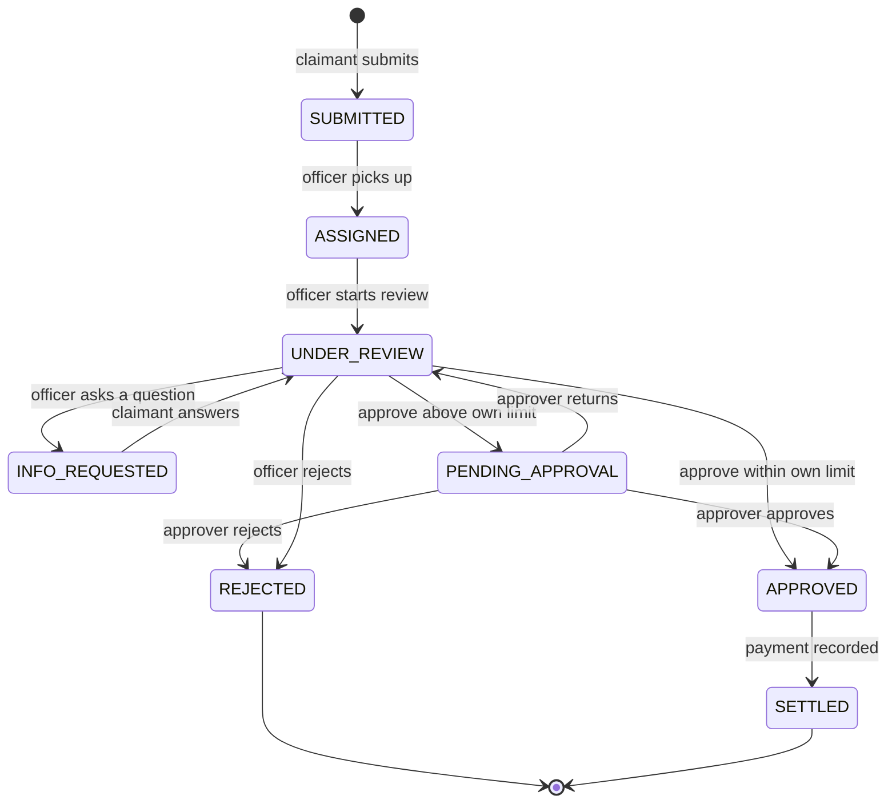
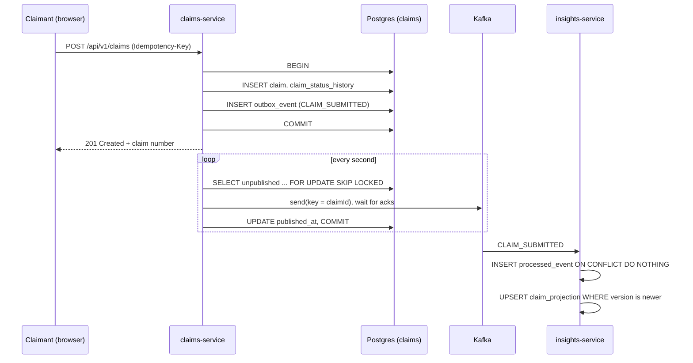

# Architecture

Feature-level detail (screens, endpoints, rules, code locations, tests) lives in [docs/features](README.md#features). Every framework and library is listed in the [tech stack](tech-stack.md).

## Overview

```mermaid
flowchart LR
    subgraph Browser
        UI[Angular app]
    end

    subgraph Edge
        NGINX[nginx<br/>static files + /api proxy]
    end

    subgraph claims-service
        API[REST API<br/>/api/v1/claims]
        DOMAIN[Claim aggregate<br/>state machine, authority rules]
        OUTBOX[(outbox_event)]
        PUB[OutboxPublisher<br/>@Scheduled, SKIP LOCKED]
    end

    subgraph insights-service
        LISTENER[ClaimEventListener<br/>idempotent, version-guarded]
        READ[(claim_projection<br/>processed_event)]
        DASH[REST API<br/>/api/v1/insights]
    end

    CLAIMSDB[(Postgres: claims)]
    KAFKA{{Kafka<br/>claims.claim-events.v1<br/>keyed by claimId}}
    DLT{{claims.claim-events.v1.dlt}}

    UI --> NGINX
    NGINX -- "/api/v1/claims, /api/v1/me" --> API
    NGINX -- "/api/v1/insights" --> DASH
    API --> DOMAIN
    DOMAIN -- "same transaction" --> CLAIMSDB
    DOMAIN -- "same transaction" --> OUTBOX
    OUTBOX --- CLAIMSDB
    PUB -- reads --> OUTBOX
    PUB -- publishes --> KAFKA
    KAFKA --> LISTENER
    LISTENER -- "after 3 retries" --> DLT
    LISTENER --> READ
    DASH --> READ
```

Two Spring Boot services, each owning its own Postgres database and login, connected only through Kafka. Neither service reads the other's tables. See [ADR 0001](adr/0001-service-boundaries.md).

| Component | Owns | Consistency |
|---|---|---|
| claims-service | Claims, status history, information requests, assessments, decisions, referrals, outbox | Strong (single ACID transaction per command, optimistic locking) |
| insights-service | One projection row per claim, processed event IDs | Eventual (typically under 2 seconds behind) |
| frontend | Nothing; it renders what the APIs return | Polls every 10 seconds |

## REST vs Kafka

The rule: **REST when a user is waiting for an answer; Kafka for facts that have already happened** ([ADR 0002](adr/0002-rest-vs-kafka.md)).

| Interaction | Transport | Why |
|---|---|---|
| Submit claim, assign, review, request/answer info, assess, decide, approve, settle | REST (POST) | The user needs the result now: a claim number, a validation error, or a 409 if someone else got there first. |
| View claim, queues, "my claims" | REST (GET) on claims-service | Must reflect the user's own change immediately (read-your-writes). |
| Dashboards (exposure, workload, performance) | REST (GET) on insights-service | Read from a separate read model; a few seconds of staleness is acceptable and shown as `asOf`. |
| `CLAIM_SUBMITTED`, `CLAIM_ASSIGNED`, `CLAIM_REVIEW_STARTED`, `INFORMATION_REQUESTED`, `INFORMATION_PROVIDED`, `CLAIM_ASSESSED`, `CLAIM_REFERRED_FOR_APPROVAL`, `REFERRAL_RETURNED`, `CLAIM_APPROVED`, `CLAIM_REJECTED`, `CLAIM_SETTLED` | Kafka | Other parts of the business react to these. Today that's reporting and claimant notifications; tomorrow it could be finance, fraud or a data lake, without claims-service knowing about them. |

The frontend sees asynchronous changes by polling. Server-Sent Events from insights-service would be the next step.

## Claim lifecycle



Transitions are enforced in the domain (`ClaimStatus.allowedNextStatuses()` and the `Claim` methods), never in controllers. Every transition appends a `claim_status_history` row and an outbox event in the same transaction. See [ADR 0004](adr/0004-claim-state-machine.md) and [ADR 0005](adr/0005-delegated-approval-authority.md).

## Write path: submit a claim



## Reliability

| Risk | Mitigation | Where |
|---|---|---|
| Dual write: DB commits but the Kafka send fails (or the reverse) | Transactional outbox: the event row commits with the state change and is published afterwards | `ClaimEventRecorder`, `OutboxPublisher`, [ADR 0003](adr/0003-transactional-outbox.md) |
| Kafka redelivers a message (at-least-once) | `processed_event` primary key + `ON CONFLICT DO NOTHING`, in the same transaction as the projection update | `ClaimEventListener` |
| Events for one claim arrive out of order (e.g. two publisher instances) | Each event carries the claim's full state and `@Version`; the projection only accepts a newer version | `ClaimProjectionRepository` |
| A poison message blocks the partition | 3 retries, 1 second apart, then the dead-letter topic; unparseable JSON skips the retries | `KafkaConfig` (insights) |
| Two officers change the same claim at once | `@Version` optimistic locking, mapped to 409 Conflict | `Claim`, `GlobalExceptionHandler` |
| Double-click or retry creates two claims | `Idempotency-Key` header, unique per claimant | `ClaimService.submit` |
| One officer approves a large claim alone | Delegated authority limits per currency, plus the four-eyes rule | `Claim.approve`, `Claim.reviewReferral` |

## Security

- HTTP Basic with stateless sessions and seeded demo users, chosen for simplicity. Production would use OIDC (Entra ID, Okta or Keycloak), with both services acting as JWT resource servers.
- Roles (`CLAIMANT`, `OFFICER`, `MANAGER`) gate endpoints with `@PreAuthorize`. Positions (L1–L4) arrive as `POSITION_*` authorities, mirroring identity-provider group claims.
- Ownership: a claimant only sees their own claims. Another claimant's claim returns 404, so its existence isn't revealed.
- Claimants never see the reserve, assessments or referral; those are internal.
- No PII in events (no policy number, no incident description). Logs contain claim numbers and statuses only.
- 401 responses carry no `WWW-Authenticate` challenge, so the browser never caches credentials. The SPA sends the header explicitly, which is why CSRF protection can be off.
- Each service has its own database login with access only to its own database. Secrets come from environment variables; Compose holds dev-only defaults.

## Money

- `BigDecimal` in Java and `NUMERIC(19,2)` in Postgres, never floating point. More than 2 decimal places is rejected, never rounded. Comparisons use `compareTo`.
- Every amount is stored with its ISO 4217 currency. A claim's currency is derived from its market.
- Exposure and authority limits are **per currency**. Nothing is ever added across currencies, so no FX conversion is needed. `CurrencyTotal.plus` refuses to mix currencies.

## Scaling

The services are stateless, so the first lever at any volume is more instances behind a load balancer.

**At 10x volume**
- Run several claims-service instances. `FOR UPDATE SKIP LOCKED` already lets publishers share the outbox, and the version-guarded consumer tolerates the reordering that follows.
- Increase topic partitions (keyed by claim ID, so per-claim ordering holds) and scale insights consumers up to the partition count.
- Add a Postgres read replica for claims-service list queries.
- Delete published outbox rows on a schedule (for example, after 7 days).
- Replace HTTP Basic plus bcrypt with OIDC tokens; bcrypt on every request is deliberately slow.

**At 100x volume**
- Cache dashboard responses (Redis, short TTL), or move aggregation into materialized views refreshed on a schedule. The read model is already separate, so this doesn't touch the write side.
- Replace the polling outbox publisher with change data capture (Debezium) on the outbox table.
- Archive closed claims to cold storage and partition the `claim` table by market or year.
- Push updates to the UI with Server-Sent Events or WebSockets instead of polling.
- Split claims-service by market if data-residency rules require it (e.g. Indonesia).

## Known limitations

- Login lockout is held in memory per service instance; with several instances, or after a restart, the count is not shared. The identity provider owns this in production.
- Security configuration is duplicated across the two services. A shared OIDC resource-server setup would replace it.
- An `Idempotency-Key` reused with a different request body is not detected (that would need a stored request hash).
- insights-service dashboards are not filtered by reporting line; workload and performance are visible to all officers.
- Employee records are maintained by seed data, not synced from an HR system.
- No pagination or time filter on dashboards; performance is all-time.
- Frontend models are hand-written to match the OpenAPI contract instead of generated from it.
