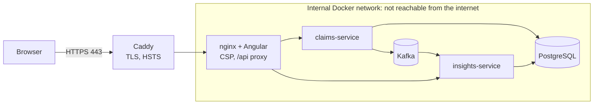

# Deployment

Two free ways to run the platform for other people. Both run the same Docker Compose stack as local development.

| | **A. GitHub Codespaces** | **B. Oracle Cloud Always Free VM** |
|---|---|---|
| Best for | A live walkthrough, or letting a reviewer click around for an hour | A permanent link to share |
| Cost | Free within the monthly Codespaces allowance | Free (Always Free tier) |
| Setup time | About 5 minutes, mostly the first build | About 30 to 45 minutes |
| URL | `https://<codespace>-4200.app.github.dev` | `https://<your-name>.duckdns.org` with a real certificate |
| Always on | No; stops after 30 minutes idle and restarts in about a minute | Yes |
| Needs | A GitHub account with access to the repo | An Oracle account (card for verification only) and a free DuckDNS name |

Free PaaS tiers (Render, Railway, Fly.io, Koyeb) were considered and ruled out: their free machines have about 512 MB of memory, which can't hold PostgreSQL, Kafka and two JVM services.

---

## A. GitHub Codespaces (quickest)

1. On the repository page: **Code → Codespaces → Create codespace on main**.
2. Wait for the first build (5 to 8 minutes). The [dev container](../.devcontainer/devcontainer.json) installs Docker, Java 21 and Node 24, and runs `docker compose up -d --build` on every start. Progress: `docker compose ps` in the terminal.
3. The app opens in the browser on forwarded port **4200**. API docs are at `/api/docs` on the same URL.
4. **To share it:** in the **Ports** tab, right-click port 4200 → *Port visibility* → **Public**, and copy the URL. Anyone with the link can then open it while the codespace runs. Set it back to *Private* afterwards.

Stop the codespace when you're done (**Codespaces → … → Stop**) so it doesn't use your free hours. Data is kept until the codespace is deleted.

---

## B. Oracle Cloud Always Free (permanent HTTPS link)

The whole stack runs on one ARM VM (4 CPU, 24 GB RAM). **Only Caddy is public**, on ports 80 and 443. It gets a Let's Encrypt certificate automatically and redirects HTTP to HTTPS. PostgreSQL, Kafka and the services are reachable only inside the Docker network.



### 1. Create the VM

1. Sign up at **cloud.oracle.com**. The card is for identity verification only.
2. **Compute → Instances → Create instance**:
   - Image: **Ubuntu 24.04**
   - Shape: **VM.Standard.A1.Flex**, 4 OCPU, 24 GB memory (all within Always Free)
   - Add your SSH public key, or download the generated private key.
   - If you see *Out of capacity*, pick another availability domain, or try again later.
3. **Networking → Virtual cloud networks → your VCN → Security lists → Default** → *Add ingress rules*: source `0.0.0.0/0`, TCP, destination ports **80** and **443**.

### 2. Get a free domain

At **duckdns.org**, sign in, create a sub-domain (for example `my-claims`), and set its IP to the VM's public IP. Your address is `my-claims.duckdns.org`.

### 3. Run the setup script

```bash
ssh ubuntu@<public-ip>
git clone <repo-url> claims && cd claims
./infra/deploy/server-setup.sh my-claims.duckdns.org --backups
```

[`server-setup.sh`](../infra/deploy/server-setup.sh) is safe to run again. It:

1. installs Docker if it's missing;
2. opens ports 80 and 443 in the VM's own firewall (Oracle's Ubuntu images block them in iptables as well as in the security list);
3. adds 4 GB of swap on machines with less than 6 GB of memory;
4. creates `.env` with **random 48-character database passwords** (file mode 600), demo data on, and API docs on;
5. checks that your domain points at this server, and warns if not;
6. builds and starts the stack, waits until it answers, and prints the URLs;
7. with `--backups`, schedules the nightly backup.

The first build takes about 10 minutes on the ARM VM. Then open **`https://my-claims.duckdns.org`**. API docs are at `/api/docs`.

> For a private repository, clone with a [fine-grained personal access token](https://github.com/settings/personal-access-tokens) that has read-only access to this repository, or with a deploy key.

### 4. Check it

```bash
curl -I https://my-claims.duckdns.org                      # 200, with Strict-Transport-Security
curl -I http://my-claims.duckdns.org                       # 308 redirect to https
cd e2e && E2E_BASE_URL=https://my-claims.duckdns.org npx playwright test   # from your laptop
```

The end-to-end suite works as a smoke test for any deployment. It creates test claims, so run it before you hand out the link, or on a separate copy.

### Updating

```bash
cd ~/claims && git pull && ./infra/deploy/server-setup.sh
```

The script reuses `.env`, rebuilds what changed and restarts it. **Never run `docker compose down -v` on the server**, because it deletes the database and document volumes.

### Backups and restore

`infra/backup/pg-backup.sh` writes both databases (`pg_dump`, custom format) and the uploaded documents (`tar.gz`) to `~/backups`, keeping 14 days. Copy them off the VM regularly, for example to Oracle Object Storage, which has a free tier of 20 GB.

```bash
COMPOSE="docker compose -f docker-compose.yml -f docker-compose.prod.yml"
$COMPOSE exec -T postgres pg_restore -U postgres -d claims --clean < ~/backups/claims-<stamp>.dump
$COMPOSE exec -T postgres pg_restore -U postgres -d insights --clean < ~/backups/insights-<stamp>.dump
$COMPOSE exec -T claims-service tar -C /data -xzf - < ~/backups/documents-<stamp>.tar.gz
```

### Troubleshooting

| Symptom | Cause and fix |
|---|---|
| Browser can't connect at all | Port 80/443 closed: check the Oracle security list (step 1.3); the script handles the VM firewall |
| Certificate warning, or Caddy logs `challenge failed` | DNS doesn't point at the VM yet, or port 80 is blocked. Fix it, then `docker compose ... restart caddy` |
| `502 Bad Gateway` right after starting | The Java services are still starting (about a minute). `docker compose ... ps` shows `healthy` when ready |
| Out of memory on a smaller VM | The script adds swap below 6 GB; 4 GB of RAM is the practical minimum |
| Logs | `docker compose -f docker-compose.yml -f docker-compose.prod.yml logs -f claims-service` |
| Inspect Kafka | Kafka UI is not started in production. Run with `--profile debug` and reach it through an SSH tunnel (`ssh -L 8090:localhost:8090`) |

Oracle may reclaim Always Free VMs that stay almost idle for 7 days. Visiting the site now and then is usually enough. Upgrading the account to *Pay As You Go* removes the risk and still costs nothing within the free limits.

---

## What the public deployment protects, and what it doesn't

| In place | Not in place (production work, see [ADR 0007](adr/0007-personal-data-protection.md)) |
|---|---|
| Only 80/443 public; HTTPS with automatic renewal; HSTS | Single sign-on with MFA instead of demo accounts |
| Random, unique database passwords in a `600` file; never in git | A secrets vault |
| Database, Kafka and Kafka UI unreachable from the internet | Encrypted volumes and off-site, encrypted backups |
| CSP, frame, sniff, referrer and permissions headers; login lockout; audit log | A web application firewall and rate limiting |

**It is a demo.** The sign-in page shows the demo accounts and the password `password`, so anyone with the link can sign in. Keep only the fictional demo data on it. For a private environment, set `DEMO_USER_PASSWORD` to something else and `DEMO_DATA_ENABLED=false` in `.env`, and add real identity before any real data.

## Rehearse locally

The production setup can be tried on any machine with Docker before touching a server:

```bash
cp .env.example .env.prod-test     # set DOMAIN=localhost and three random passwords
docker compose -p claims-prodtest --env-file .env.prod-test -f docker-compose.yml -f docker-compose.prod.yml up -d --build
E2E_BASE_URL=https://localhost E2E_IGNORE_HTTPS_ERRORS=true npx playwright test   # in e2e/
docker compose -p claims-prodtest --env-file .env.prod-test -f docker-compose.yml -f docker-compose.prod.yml down -v
```

Caddy issues a local certificate for `localhost`. This rehearsal ran with all 69 end-to-end tests passing over HTTPS, and only ports 80 and 443 reachable.
