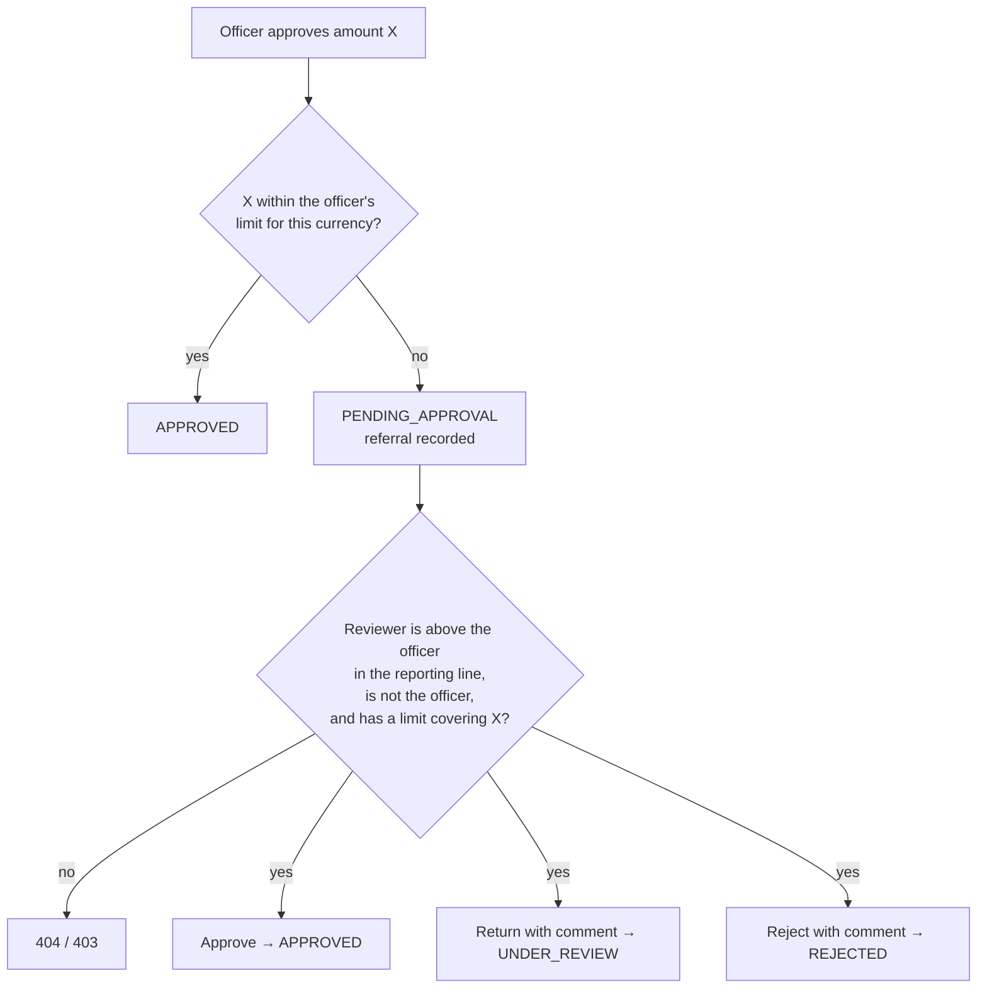

# Approvals and delegated authority

> Beyond the brief. In insurance, how much an employee may approve depends on their position: **delegated authority**. A large approval needs a second, more senior person (**four-eyes**). Decision record: [ADR 0005](../adr/0005-delegated-approval-authority.md).

## Limits per position and currency

| Position | SGD | MYR | HKD | THB | IDR | PHP |
|---|---|---|---|---|---|---|
| Claims Officer | 10k | 30k | 60k | 250k | 100M | 400k |
| Senior Claims Officer | 50k | 150k | 300k | 1.25M | 500M | 2M |
| Team Lead | 250k | 750k | 1.5M | 6M | 2.5B | 10M |
| Claims Manager | unlimited | | | | | |

Limits are set in `app.authority.limits` **per currency**, so no exchange rate is ever involved.

## Flow

Three rules must all hold for someone to review a referral:
1. **Four-eyes:** the person who recommended the amount can never approve it.
2. **Reporting line:** the reviewer must be above the recommending officer, directly or indirectly ([employees](employees-and-hierarchy.md)).
3. **Authority:** the reviewer's own limit must cover the amount.

## The Approvals inbox

**Approvals** in the sidebar adapts to who you are:

| You are | Tabs |
|---|---|
| Someone with people below you (lead1, lead2, manager1) | **To review**: pending referrals from your reporting line; **Decided**: ones you have dealt with; **My referrals** |
| An officer with nobody below you | **My referrals** only |

Each row shows:
- the claim, the recommended and claimed amounts, and who referred it and when;
- a status of **Pending**, **Approved**, **Returned** or **Rejected**;
- who reviewed it.

A **Review** button appears only where the domain rules say you can act.

The status is **derived from the claim's own audit trail**: the latest history entry that leaves `PENDING_APPROVAL`. It is never stored twice, so it can't drift out of step with the claim. A referral that was returned and later referred again shows as Pending.

`GET /api/v1/claims/approvals?view=TO_REVIEW|DECIDED|MY_REFERRALS`, then `POST /api/v1/claims/{id}/approval` with `{ outcome: APPROVE|RETURN|REJECT, comment }`.

## Code

| Layer | Location |
|---|---|
| Limits | `claim/application/AuthorityLimits.java`, `claim/domain/ApprovalLimit.java` |
| Rules | `claim/domain/Claim.java` (`decide`, `reviewReferral`), `Actor.java` |
| Inbox | `claim/application/ApprovalMapper.java`, `ClaimService.findApprovals` |
| Screen | `frontend/src/app/features/approvals` |

## Tests

- `AuthorityLimitsTest`, `ClaimTest`: referral, four-eyes, reporting line, limits.
- `ApprovalMapperTest`: status derived from history, including a returned referral that is referred again.
- e2e `04-approvals.spec.ts`: referral → lead approves; a lead outside the reporting line can't see it; within the limit, the decision is final.
