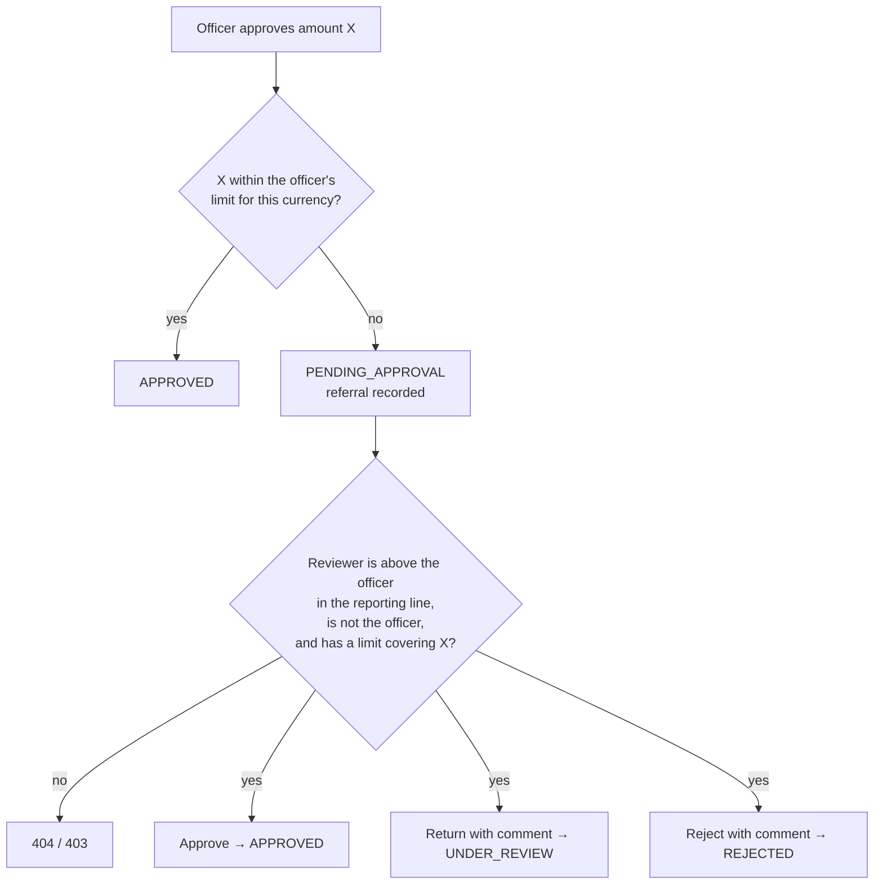

# Approvals and delegated authority

> Beyond the brief. In insurance, how much an employee may approve depends on their position: **delegated authority**. A large approval needs a second, more senior person (**four-eyes**). Decision record: [ADR 0005](../adr/0005-delegated-approval-authority.md).

## Limits per position and currency

| Position | SGD | MYR | HKD | THB | IDR | PHP |
|---|---|---|---|---|---|---|
| Claims Officer | 10k | 30k | 60k | 250k | 100M | 400k |
| Senior Claims Officer | 50k | 150k | 300k | 1.25M | 500M | 2M |
| Team Lead | 250k | 750k | 1.5M | 6M | 2.5B | 10M |
| Claims Manager | unlimited | | | | | |

Limits are set in `app.authority.limits` **per currency**, so no exchange rate is ever involved.

## Flow

Three rules must all hold for someone to review a referral:
1. **Four-eyes:** the person who recommended the amount can never approve it.
2. **Reporting line:** the reviewer must be above the recommending officer, directly or indirectly ([employees](employees-and-hierarchy.md)).
3. **Authority:** the reviewer's own limit must cover the amount.

## Designed for people who aren't technical

Approvals are where money is committed, and many approvers aren't technical. The screens avoid internal terms like "referral", "reserve" or "return" and explain each step in plain words.

### Approvals inbox

**Approvals** in the sidebar opens with a three-step explainer (an officer recommends a payment → above their limit, a senior colleague signs off → approve, send back or decline), then adapts to who you are:

| You are | Tabs |
|---|---|
| Someone with people below you (lead1, lead2, manager1) | **Waiting for me**: payments your team recommended above their own limit; **Decided**: ones already signed off; **Sent by me** |
| An officer with nobody below you | **Sent by me** only |

Each item is a card that reads like a sentence:
- **Recommended payment** SGD 78,000 *of SGD 85,000 claimed*;
- **Recommended by Daniel Lim**, waiting 3 hours (real names, not usernames);
- the officer's reason, quoted;
- a plain status: **Waiting for decision**, **Approved**, **Sent back to officer** or **Declined**, with who decided and when;
- **Review and decide** only where you're allowed to act, otherwise **View claim**.

### On the claim: "Approval needed"

While a claim waits for sign-off, staff see a panel at the top of the claim page:

| Part | What it shows |
|---|---|
| Progress tracker | ✓ Officer recommended → **Senior sign-off** (now) → Approved for payment |
| The ask, in one sentence | "Daniel Lim recommends paying **SGD 78,000**. That's above Daniel's approval limit of **SGD 10,000**, so a more senior colleague has to sign it off." |
| Amounts side by side | Claimed by the customer, expected cost from the assessment, and the recommended payment, as bars with the officer's limit marked |
| The officer's reason | Quoted |
| **Your decision** (approver only) | Three buttons that say what happens: **Approve payment** (approved at the recommended amount; the officer arranges payment), **Send back for changes** (back to the officer; you say what to change), **Decline the claim** (rejected; your reason is shared with the customer) |
| For the officer who asked | "Sent for sign-off. Anyone above you in your team with a high enough limit, usually your team lead, can decide." |

The decision buttons live only in the panel, not in the page header, so there is one obvious place to decide. Each opens a short dialog that repeats what will happen and asks for the note, change request or reason. Every button's accessible name is its title, and the explanation is attached as its description, so screen readers announce "Approve payment" followed by what it does.

The status is **derived from the claim's own audit trail**: the latest history entry that leaves `PENDING_APPROVAL`. It is never stored twice, so it can't drift out of step with the claim. A referral that was returned and later referred again shows as Pending.

`GET /api/v1/claims/approvals?view=TO_REVIEW|DECIDED|MY_REFERRALS`, then `POST /api/v1/claims/{id}/approval` with `{ outcome: APPROVE|RETURN|REJECT, comment }`.

## Code

| Layer | Location |
|---|---|
| Limits | `claim/application/AuthorityLimits.java`, `claim/domain/ApprovalLimit.java` |
| Rules | `claim/domain/Claim.java` (`decide`, `reviewReferral`), `Actor.java` |
| Inbox | `claim/application/ApprovalMapper.java`, `ClaimService.findApprovals` |
| Screens | `frontend/src/app/features/approvals` (inbox), `features/claims/claim-detail/approval-panel` (Approval needed panel), `core/people.service.ts` (names) |

## Tests

- `AuthorityLimitsTest`, `ClaimTest`: referral, four-eyes, reporting line, limits.
- `ApprovalMapperTest`: status derived from history, including a returned referral that is referred again.
- e2e `04-approvals.spec.ts`: referral → lead approves; a lead outside the reporting line can't see it; within the limit, the decision is final.
