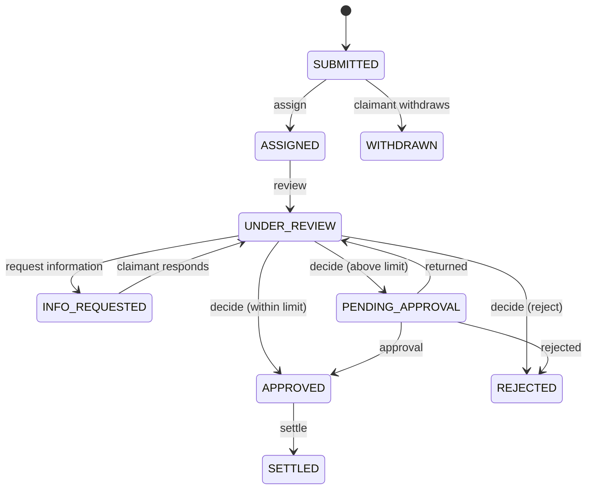

# Claim handling

> **Brief:** *Claims staff need to be able to pick up incoming claims, review and assess them, progress claims to settlement or rejection.*

## Lifecycle

Every allowed transition is defined in one place: an exhaustive `switch` in `ClaimStatus`. Adding a status without deciding its transitions is a compile error. A test checks all 64 status pairs against an independently written table. Why: [ADR 0004](../adr/0004-claim-state-machine.md).

## Officer actions

| Action | From | Endpoint | Effect |
|---|---|---|---|
| **Assign to me** | Submitted | `POST /claims/{id}/assignment` | Officer owns the claim |
| **Start review** | Assigned | `POST /claims/{id}/review` | Work begins |
| **Request info** | Under review | `POST /claims/{id}/information-requests` | Waiting on the claimant |
| **Assess** | Under review | `POST /claims/{id}/assessment` | Sets the **reserve** (expected cost); each assessment is kept |
| **Approve** | Under review | `POST /claims/{id}/decision` `APPROVED` | Approved, or referred if above the officer's limit ([approvals](approvals.md)) |
| **Reject** | Under review | `POST /claims/{id}/decision` `REJECTED` | Rejected with a reason |
| **Mark settled** | Approved | `POST /claims/{id}/settlement` | Payment recorded; the reserve leaves exposure |

Only the **assigned officer** can act on a claim. Approval needs an assessment first, and the approved amount can't exceed the claimed amount.

## Work lists

| Menu | Shows |
|---|---|
| **Claims → Queue** | Unassigned claims, oldest first |
| **Claims → Assigned to me** | My open claims |
| **Claims → All open** | Open claims of mine and everyone below me in the reporting line |
| **Claims → History** | Settled and rejected claims in my scope |

`GET /api/v1/claims?status=&assignedTo=&closed=&page=&size=` serves all four. Results are paged and built from JPA Specifications.

## The UI never guesses

Each claim response includes `allowedActions` for the **current user**. The buttons on the claim page come straight from that list, so a button is never shown for an action the server would refuse. The server computes it with the same rules that guard the commands.

## Concurrency

The `claim` table has a `@Version` column, giving optimistic locking. If two officers press **Assign to me** at the same moment, one wins and the other gets **409 Conflict** with a clear message. Nobody's change is lost silently.

## Audit

Every status change is written to `claim_status_history` with the actor, the time and the reason. The officer's commands also publish events through the outbox ([events](events-and-messaging.md)).

## Code

| Layer | Location |
|---|---|
| Screens | `features/claims/claim-list` (one component, driven by route data), `features/claims/claim-detail` |
| Service | `claim/application/ClaimService.java` (`act(...)` loads, checks visibility, applies, records the event) |
| Domain | `claim/domain/Claim.java`, `ClaimStatus.java`, `Actor.java`, `ClaimAction.java` |
| Queries | `claim/infrastructure/ClaimSpecifications.java` |

## Tests

- `ClaimStatusTest` (64 pairs) and `ClaimTest`.
- `OptimisticLockingIT`: a concurrent update against real PostgreSQL.
- e2e `03-officer-lifecycle.spec.ts`: queue to settlement, rejection, simultaneous assignment, buttons only when allowed.
