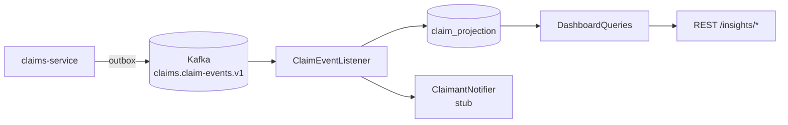

# Dashboards and insights

> **Brief:** *Claims staff need to see their team's workload and performance. Managers have no real-time picture of outstanding claims or liability exposure.*

## Reports

| Report | Who | Screen | Endpoint |
|---|---|---|---|
| **Exposure**: outstanding reserve and open claims per currency, market and claim type | Manager | **Overview** | `GET /api/v1/insights/exposure` |
| **Workload**: open claims per officer and status, unassigned count | Officers, manager | **Team → Performance**, **Overview** | `GET /api/v1/insights/workload` |
| **Performance**: decisions per team, approved, rejected and closed counts, average hours from submission to decision | Officers, manager | **Team → Performance** | `GET /api/v1/insights/performance` |

**Money is never mixed.** Totals are always per currency. Adding SGD to IDR would produce a meaningless number, and converting needs an exchange-rate policy, which is out of scope.

## Where the numbers come from

- insights-service keeps its own **read model**, `claim_projection`, with one row per claim and the latest state. It never queries the claims database.
- Each event carries a full **snapshot with a version number**. An update only applies if its version is newer, so events arriving twice or out of order can't roll the state back.
- `processed_event` records every event ID (`ON CONFLICT DO NOTHING`), so a redelivered event is skipped.
- A message that can't be read goes to `claims.claim-events.v1.DLT` after 3 retries, instead of blocking the partition.

Each report carries `asOf`, the time of the latest event applied, and the UI shows **Updated hh:mm:ss**. The dashboards are honest that they are near-real-time. Screens that need the exact current state, such as the claim page, read from claims-service instead.

## Personal data

The read model holds **no personal data**: only IDs, codes, amounts and timestamps. The analytics side can be opened to more users and tools without a privacy review of its contents ([ADR 0007](../adr/0007-personal-data-protection.md)).

## Code

| Layer | Location |
|---|---|
| Consumer | `services/insights-service/.../projection/ClaimEventListener.java`, `ClaimProjectionRepository.java` |
| Reports | `dashboard/DashboardService.java`, `DashboardQueries.java`, `ExposureReport.java`, `WorkloadReport.java`, `PerformanceReport.java` |
| Screens | `frontend/src/app/features/manager/dashboard`, `features/team` |

## Tests

- `ExposureReportTest`, `WorkloadReportTest`, `PerformanceReportTest`: per-currency totals, weighted averages, grouping.
- `ClaimEventListenerIT` (real Kafka and PostgreSQL): duplicates and stale versions ignored, poison message goes to the DLT.
- e2e `05-insights.spec.ts`: a new assessment reaches the exposure report **through Kafka**; claimants and officers get 403.
