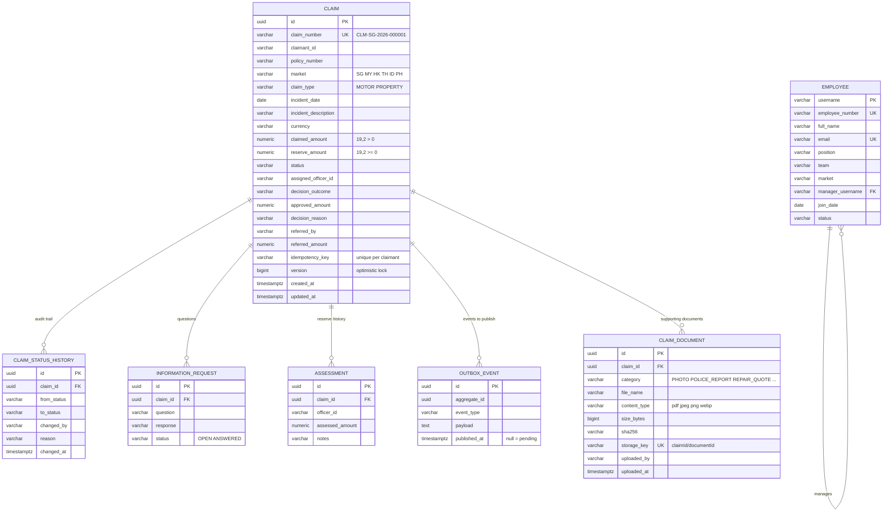

# Data model

Each service owns its database. Neither reads the other's. The schema is created and changed only by **Flyway** migrations, and Hibernate runs with `ddl-auto: validate`, so the app refuses to start if the entities and schema disagree.

## claims-service (system of record)

## insights-service (read model)

| Table | Purpose |
|---|---|
| `claim_projection` | Latest state of each claim from events: IDs, codes, amounts and timestamps only. **No personal data.** |
| `processed_event` | Event IDs already applied, so a redelivery is skipped. |

## Design choices

| Choice | Why |
|---|---|
| `NUMERIC(19,2)` and a currency on every amount | Exact money; never `double`. Totals are only ever made per currency. |
| `TIMESTAMPTZ` | Six markets in five time zones; everything is stored in UTC. |
| UUID primary keys and a separate human claim number | IDs can be generated anywhere without a round trip; the claim number is for people. |
| `@Version` column | Optimistic locking: concurrent updates fail with 409 instead of being lost. |
| Decision and referral columns embedded on `claim` | One-to-one with the claim, read with it every time; no join. |
| CHECK constraints on every code and on "all or nothing" groups | The database rejects an invalid status, or a half-written decision, referral or answer, even from a bug or manual SQL. |
| Partial indexes (`outbox_event` unpublished, `claim` referred) | Small and fast for the exact queries the publisher and approvals inbox run. |
| Recursive query on `employee` | Reporting line of any depth, with no fixed number of levels. |

## Migrations

| Version | Change |
|---|---|
| V1 | Claim, status history, information requests, assessments |
| V2 | Transactional outbox |
| V3 | Referral (delegated approval) |
| V4 | Employee directory |
| V5 | Domain CHECK constraints and the approvals index |
| V6 | Supporting documents (metadata; content in `DocumentStorage`) |

Migrations are append-only. Once committed, a migration is never edited; a fix is a new version.
