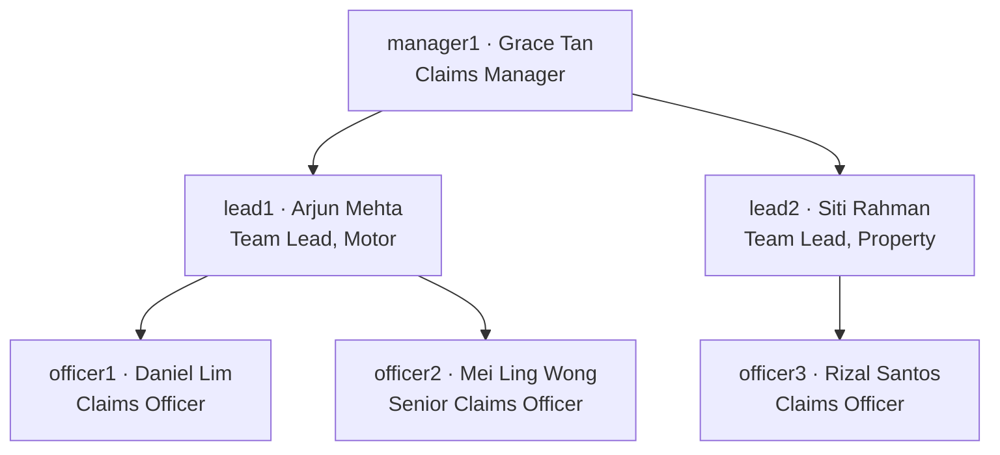

# Employees and reporting line

> Beyond the brief. The reporting line decides **who can see which claims and people** and **who can approve a referral**. Decision record: [ADR 0006](../adr/0006-reporting-line-visibility.md).

## Directory

Each employee record holds:
- employee number, name, email and phone;
- position, department, team and market;
- office, join date, employment type and status;
- `manager_username`, which builds the tree.

## Visibility: below, never above

| You can see | You cannot see |
|---|---|
| Yourself and everyone below you, at any depth | Your manager's or a peer's profile (404) |
| Claims that are unassigned, or assigned to you or anyone below you | Claims held by peers or people above you (404) |
| Your own manager's **name and position**, on your profile | Anything else about people above you |

"Everyone below" is a **recursive SQL query** (`WITH RECURSIVE`) using `UNION`. If bad data ever created a cycle, the query still stops.

## Screens

| Screen | Endpoint |
|---|---|
| **Team → People**: searchable directory and org tree | `GET /api/v1/employees?q=&page=&size=` |
| A person's profile: overview, team, approval authority | `GET /api/v1/employees/{username}` |
| **Account → My profile**: edit phone and office | `GET`, `PATCH /api/v1/employees/me` |

Only phone and office can be edited. Everything else belongs to the HR system of record.

## Positions and sign-in

- **Logins** (username, password, role) come from configuration.
- **Position** is loaded from the employee directory at sign-in and added as a `POSITION_*` authority. This mirrors an identity provider syncing groups from HR.
- In production, the directory would be fed from HR (for example Workday) through SCIM.

## Code

| Layer | Location |
|---|---|
| Domain and data | `employee/domain/Employee.java`, `employee/infrastructure/EmployeeRepository.java` (recursive query) |
| Service and API | `employee/application/EmployeeService.java`, `employee/api/EmployeeController.java` |
| Migration | `V4__create_employee.sql` (self-reference, no-self-manager check), `V5` (code checks) |
| Screens | `frontend/src/app/features/people`, `shared/org-tree` |

## Tests

- `EmployeeServiceTest`: visibility rules.
- `EmployeeRepositoryIT`: the recursive query against real PostgreSQL.
- e2e `04-approvals.spec.ts`: a lead outside the line gets 404.
