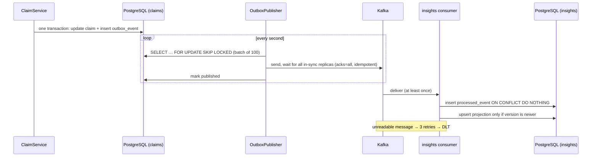

# Events and messaging

> **Brief:** *REST/HTTP and Kafka. You decide what uses which.* Decision records: [ADR 0002](../adr/0002-rest-vs-kafka.md) (REST vs Kafka) and [ADR 0003](../adr/0003-transactional-outbox.md) (outbox).

## The rule

| Use | When | Examples |
|---|---|---|
| **REST** | Someone is waiting for the answer, or the call must succeed or fail now | Submit, assign, assess, decide, read a claim |
| **Kafka** | A fact has already happened and others react to it in their own time | Dashboards, claimant notifications, and later fraud scoring or payments |

## Topic and contract

| | |
|---|---|
| Topic | `claims.claim-events.v1` (3 partitions; version in the name so a breaking change gets a new topic) |
| Key | Claim ID, so all events of one claim stay in order on one partition |
| Dead-letter topic | `claims.claim-events.v1.DLT` |
| Event types | `CLAIM_SUBMITTED`, `CLAIM_ASSIGNED`, `CLAIM_REVIEW_STARTED`, `INFORMATION_REQUESTED`, `INFORMATION_PROVIDED`, `CLAIM_ASSESSED`, `CLAIM_REFERRED_FOR_APPROVAL`, `REFERRAL_RETURNED`, `CLAIM_APPROVED`, `CLAIM_REJECTED`, `CLAIM_SETTLED` |

```json
{
  "eventId": "6b1f…",
  "eventType": "CLAIM_ASSESSED",
  "occurredAt": "2026-11-20T09:15:02Z",
  "actor": "officer1",
  "claim": {
    "id": "…", "version": 4, "claimNumber": "CLM-SG-2026-000004",
    "claimantId": "claimant1", "market": "SG", "claimType": "MOTOR", "status": "UNDER_REVIEW",
    "currency": "SGD", "claimedAmount": 6800.00, "reserveAmount": 6500.00,
    "assignedOfficerId": "officer1", "submittedAt": "…", "decidedAt": null
  }
}
```

Every event carries a **full snapshot plus the version**, not just what changed. A consumer never needs to call back into claims-service, and can always tell which of two events is newer.

## Reliability, end to end



| Failure | Result |
|---|---|
| Kafka down when a claim is updated | The claim still saves; the event waits in `outbox_event` and is sent when Kafka is back. |
| App crashes after sending, before marking published | The event is sent again; the consumer skips the duplicate by `eventId`. |
| Two publisher instances | `SKIP LOCKED` gives each instance different rows. |
| Events arrive out of order | The projection keeps the higher `version`. |
| Malformed message | Goes to the DLT; the partition keeps moving. |

## Code

| Part | Location |
|---|---|
| Event and recorder | `claims-service/.../events/ClaimEvent.java`, `ClaimEventRecorder.java` |
| Outbox | `outbox/OutboxWriter.java`, `OutboxPublisher.java`, `V2__create_outbox_event.sql` |
| Consumer | `insights-service/.../projection/ClaimEventListener.java`, `common/config/KafkaConfig.java` (error handler, DLT) |

## Tests

- `ClaimEventsIT` (real PostgreSQL and Kafka): the claim and its event commit together; a rejected command writes no event; events arrive in version order, keyed by claim.
- `ClaimEventListenerIT`: duplicate, stale and poison messages.

Browse the events live in Kafka UI at http://localhost:8090.
