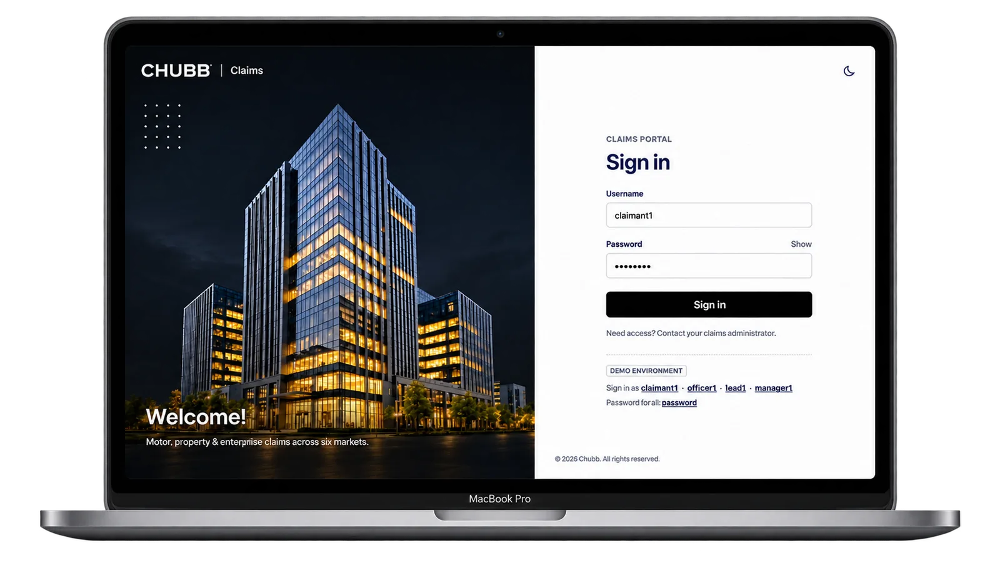

# Frontend

> **Brief:** *Both user types access the same Angular application.*



## One app, adapted per user

The same Angular app serves claimants, officers, team leads and managers:

| User | Lands on | Sidebar |
|---|---|---|
| Claimant | My claims | **Claims:** New claim · My claims · History |
| Officer, team lead | Claim queue | **Claims:** Queue · Assigned to me · All open · History — **Approvals** — **Team:** Performance · People — **Account:** My profile |
| Manager | Overview dashboard | **Overview** — **Claims:** All open · History — **Approvals** — **Team** — **Account** |

Routes are guarded by role (`canMatch`), so a claimant can't reach staff pages by typing a URL. Inside a page, buttons come from the server's `allowedActions`, so the UI never re-implements business rules.

## Structure

```
frontend/src/app/
  core/        services used everywhere: auth, API clients, interceptors, theme, toasts, models
  layout/      shell (sidebar, top bar, breadcrumbs) and page header
  shared/      reusable UI: claim table, status tag, modal, pager, avatar, bar chart, org tree, logo
  features/    one folder per area, each lazy-loaded
    login/  claimant/  claims/  approvals/  team/  manager/  people/
```

## How it is built

| Choice | Why |
|---|---|
| **Standalone components, signals, zoneless** | The current Angular model: less boilerplate, change detection only where state changes. |
| **Lazy-loaded routes** | Initial bundle 311 kB (85 kB over the wire); each area loads when first opened. |
| **One list component driven by route data** | Queue, Assigned to me, All open and History are the same component with a different `view`. |
| **Polling every 10 s** (`shared/polling.ts`) | Shows changes made by other users and by events, without WebSockets. Server-Sent Events are the next step. |
| **Interceptors** | `auth.interceptor` adds the credentials; `error.interceptor` turns Problem Details into toasts and signs out on 401. |
| **Typed API clients** | `claims-api.service.ts`, `employees-api.service.ts`, `insights-api.service.ts` with models in `core/models.ts`. |

## Design system

No UI component library: the components are written in this repo, so there are no licence costs, no unused weight and full control over accessibility. All styling uses design tokens in `src/styles.scss`:

| Token group | Examples |
|---|---|
| Colour | `--app-primary`, `--app-success`, `--app-warning`, `--app-danger`, `--app-muted`, surfaces and borders |
| Shape and depth | `--app-radius`, `--app-shadow` |
| Themes | Light by default; dark via `:root.app-dark`, toggled in the top bar and remembered per browser |

Shared classes: `.btn` (primary, dark, success, outline, danger, ghost, icon), `.input`, `.select`, `.textarea`, `.tag`, `.data-table`, `.tabs`, `.segmented`, `.empty-state`, `.surface-card`.

| Asset | Source | Licence |
|---|---|---|
| Font: Plus Jakarta Sans | Google Fonts | SIL Open Font License |
| Icons: Material Symbols Rounded (only the icons used are downloaded) | Google Fonts | Apache 2.0 |
| Charts | Chart.js 4 | MIT |

## Accessibility and quality

- WCAG 2.1 AA colour contrast in the light theme, correct heading order, and decorative icons hidden from screen readers (`aria-hidden`).
- Every form field has a label and every icon-only button has an accessible name. Dialogs use `role="dialog"`.
- Lighthouse: Accessibility 100 and Best Practices 100 on the sign-in page and on 11 signed-in pages.
- axe-core runs in the e2e suite on every main page.
- Responsive from phone to desktop; the sidebar becomes a slide-out menu on small screens.

## Run on its own

```bash
cd frontend
npm ci
npm start          # http://localhost:4200, proxies /api to localhost:8081 and :8082
npm test           # Vitest unit tests
npx ng build       # production build in dist/
```
