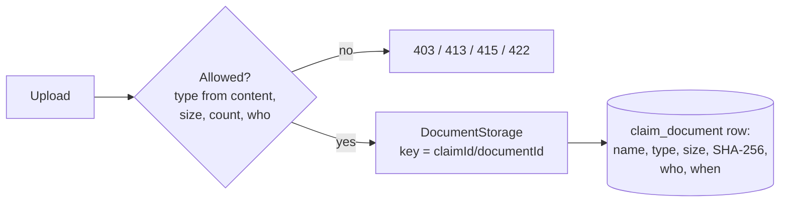

# Supporting documents

> **Brief:** *Claimants need to … provide additional information when asked.* Claims are decided on evidence: photos of the damage, a police report, a repair quote, invoices, a loss adjuster's report. Decision record: [ADR 0008](../adr/0008-document-storage.md).

## What users can do

| Who | Where | What |
|---|---|---|
| Claimant | **New claim** form, *Supporting documents* | Attach files while reporting the incident; choose what each file is |
| Claimant | Claim page, *Supporting documents* | Add more files at any time while the claim is open, for example in answer to an officer's question |
| Assigned officer | Claim page | Add evidence such as a loss adjuster's report |
| Anyone who can see the claim | Claim page | See every file with type, size, who added it and when; view or download it |

Images show as thumbnails. PDFs open in a new tab. **Whoever added a document can remove it until a claims officer picks up the claim** (for example a duplicate upload). After that, documents are part of the evidence trail and can't be removed.

## Rules

| Rule | Why |
|---|---|
| PDF, JPEG, PNG or WebP only, **detected from the file's content**, not its name or the browser's claim | A renamed HTML page or executable is rejected (415) |
| Up to **10 MB** per file (413) and **20** per claim (422) | Protects storage and keeps claims reviewable |
| Upload: the claimant who owns the claim, or the assigned officer, **while the claim is open** (otherwise 403) | Matches who works the claim; a decided claim's evidence is frozen |
| View and download: anyone who can see the claim; anyone else gets **404** | Same visibility as the claim itself |
| Remove: only whoever added it, and only before an officer picks up the claim (otherwise 403) | Mistakes can be fixed early; the evidence is frozen once someone works on it |
| Every upload, download and removal is written to the `AUDIT` log | PDPA accountability |

The browser checks size and type first, for instant feedback. The server checks again; it never trusts the browser.

## API

| Method | Path | |
|---|---|---|
| GET | `/api/v1/claims/{claimId}/documents` | List, oldest first |
| POST | `/api/v1/claims/{claimId}/documents` | Multipart: `file` and `category`; returns 201 with `Location` |
| GET | `/api/v1/claims/{claimId}/documents/{documentId}/content` | The file |
| DELETE | `/api/v1/claims/{claimId}/documents/{documentId}` | Remove; 204 |

Categories: `PHOTO`, `POLICE_REPORT`, `REPAIR_QUOTE`, `INVOICE`, `PROOF_OF_OWNERSHIP`, `ADJUSTER_REPORT` (offered to staff), `OTHER`.

Downloads are sent with `Content-Disposition: attachment`, `Cache-Control: no-store`, `X-Content-Type-Options: nosniff` and `Content-Security-Policy: sandbox`, so a file is never cached by a shared proxy and can never run as a page. Try it at **http://localhost:4200/api/docs** → *Documents*.

## Storage

- **Metadata** lives in the `claim_document` table (V6). CHECK constraints allow only the known categories and content types, and a 64-character hex SHA-256.
- **Content** goes through the `DocumentStorage` interface. This build writes to a Docker volume (`documents-data`) under generated keys. The user's file name is stored only as metadata and never used as a path, and the storage refuses any key that would leave its root. Files are written to a temporary file and moved into place atomically.
- If the database insert fails, the stored file is deleted, so no file is left without a record.
- Uploading a document doesn't change the claim row, so it never conflicts with an officer working on the claim at the same time.

In production, `DocumentStorage` becomes S3, Azure Blob or GCS with server-side encryption, and a virus-scanning step sits before a file becomes visible.

## Code

| Layer | Location |
|---|---|
| API | `document/api/DocumentController.java`, `dto/DocumentResponse.java` |
| Rules | `document/application/DocumentService.java`, `claim/domain/Claim.acceptsDocumentsFrom` |
| Type detection | `document/domain/DocumentType.java` |
| Storage | `document/infrastructure/DocumentStorage.java`, `FileSystemDocumentStorage.java` |
| Screens | `features/claims/claim-detail/documents-card`, `features/claimant/submit-claim` |

## Tests

- `DocumentTypeTest`: real signatures accepted; HTML, SVG, executables, WAV and truncated files rejected.
- `DocumentServiceTest`: who may upload, closed claims, empty files, the limit per claim, file-name cleaning (path segments, control characters, length), and the stored file removed when the insert fails.
- `FileSystemDocumentStorageTest`: round trip, path traversal refused, no partial files.
- `DocumentControllerTest`: multipart upload, 400 and 415, download headers, internal storage key never exposed.
- `DocumentsIT` (real PostgreSQL): byte-for-byte round trip, another claimant gets 404, the database rejects unknown categories and types.
- e2e `09-documents`: attach while reporting, officer downloads the claimant's file, a disguised file is refused, visibility and closed-claim rules.
