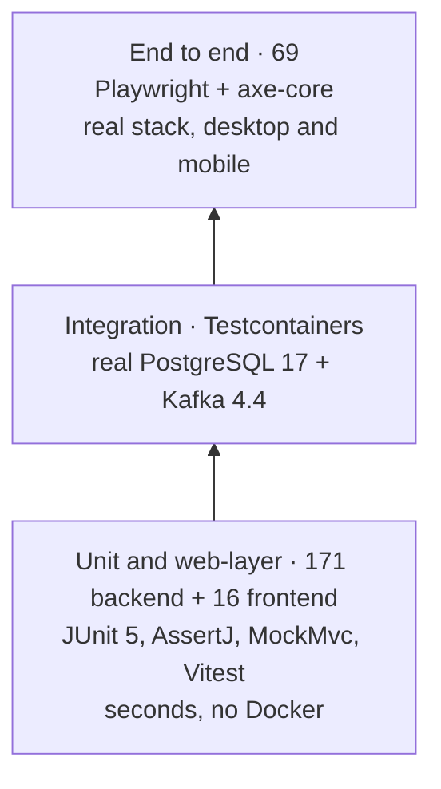

# Testing

Tests are layered so most checks are fast and a few are realistic:

| Layer | Command | What it proves |
|---|---|---|
| Unit and web | `./mvnw test` in each service | State machine (all 64 status pairs), business rules, approval limits, four-eyes, report maths, API validation, security and Problem Details mapping, login lockout |
| Frontend unit | `npm test -- --watch=false` | Session storage and sign-out, error interceptor behaviour, a regression test for the tab re-select bug (proven to fail without the fix), label formatting |
| Integration | `./mvnw verify` | The live OpenAPI spec matches the committed contract and every operation is documented; document storage round trip; Flyway schema matches the entities; claim and outbox event commit together; events reach Kafka in order; optimistic locking; recursive reporting-line query; duplicate, stale and poison events |
| End to end | `cd e2e && npx playwright test` | Every requirement in the brief through the browser as each user type; Kafka-fed dashboards; security headers; WCAG 2.1 AA |
| Performance and accessibility audit | Lighthouse | 100 accessibility and best practices on 12 pages |

## Continuous integration

[`.github/workflows/ci.yml`](../../.github/workflows/ci.yml) runs on every push and pull request:

1. **Backend**, both services in parallel: `./mvnw verify` (unit, web-layer and Testcontainers integration tests).
2. **Frontend**: Prettier check, Vitest unit tests, production build.
3. **End to end**, after both pass: the whole stack in Docker Compose, then the Playwright suite. On failure the HTML report, traces, screenshots, videos and service logs are uploaded as an artifact.

## Conventions

- **Test names state the rule:** `aRejectedCommandWritesNoOutboxEvent`, `a lead outside the officer's reporting line cannot see or review the referral`.
- **The clock is injected** (`Clock` bean), so time-based rules are tested without waiting.
- **The state machine is checked against an independent table**, not against its own code.
- **End to end: arrange through the API, act and assert through the UI.** Each test creates its own data and runs in parallel.
- **Locators by role and label**, the way a screen reader finds things.

## What the tests caught

- A test wrongly assumed an officer could see a colleague's claim. The reporting-line rule was correct; the test was fixed.
- The e2e suite found that every claim dialog reloaded the page and signed the user out, a bug no unit test could see.
- axe-core and Lighthouse found low-contrast colours and icons read aloud by screen readers.

Details per suite: [e2e/README.md](../../e2e/README.md).
