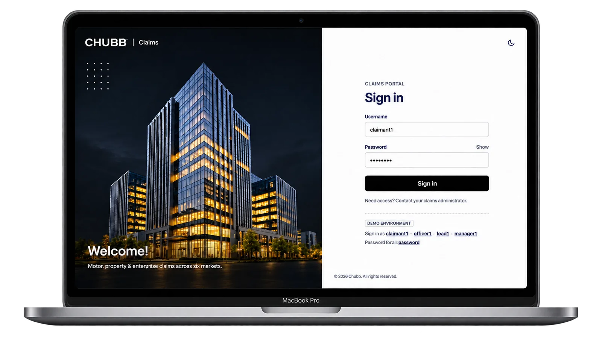
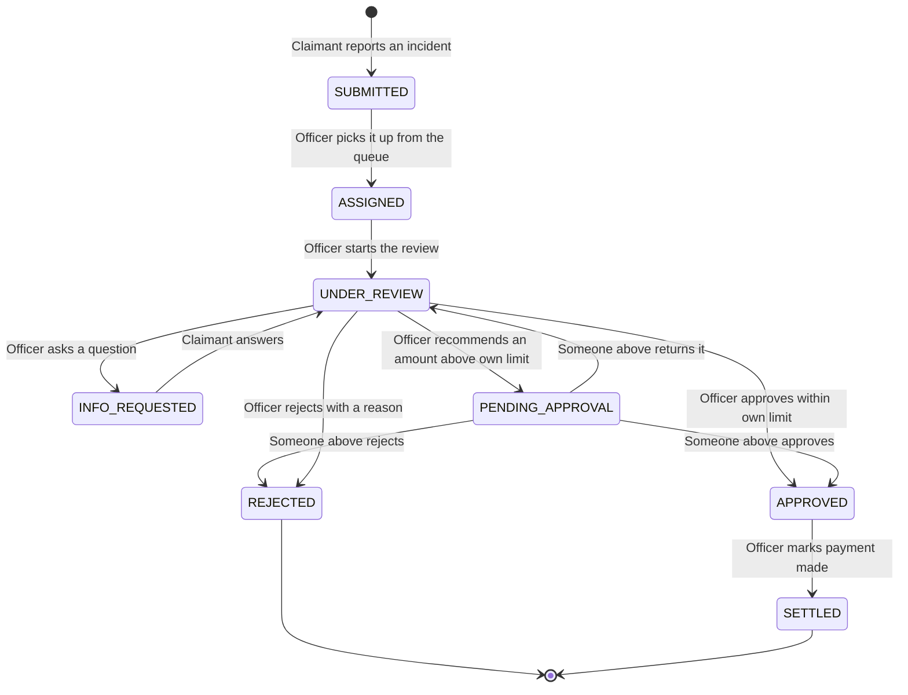
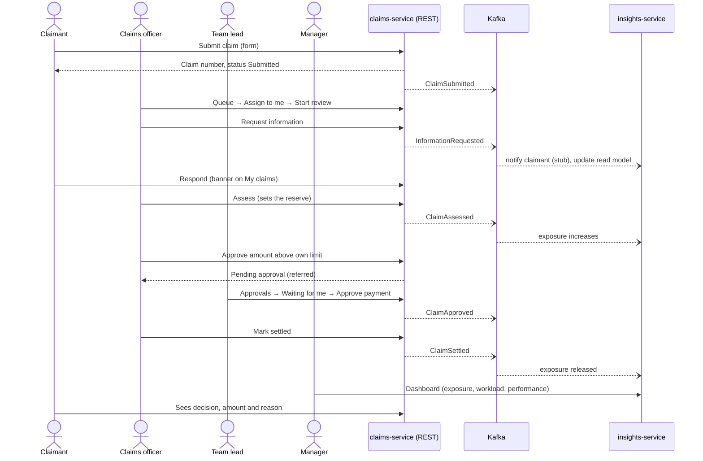
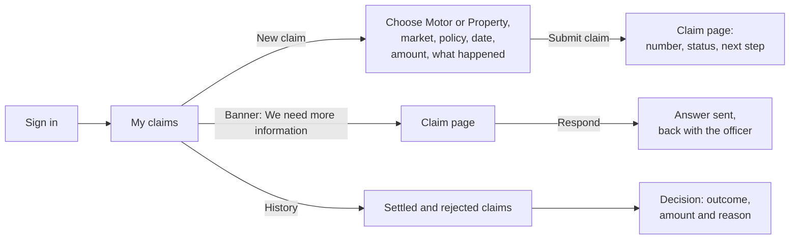
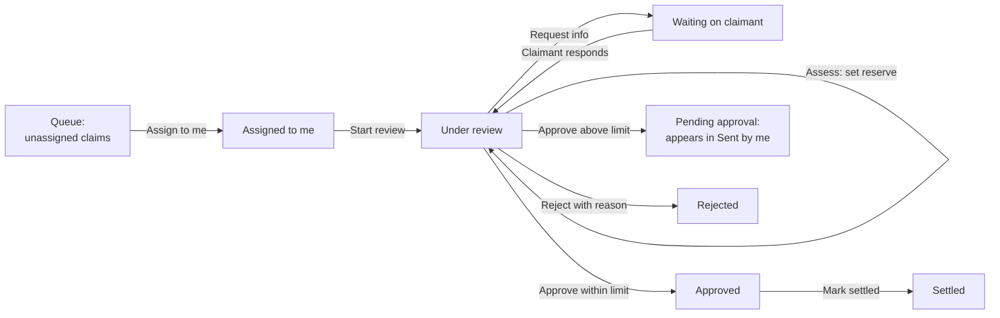
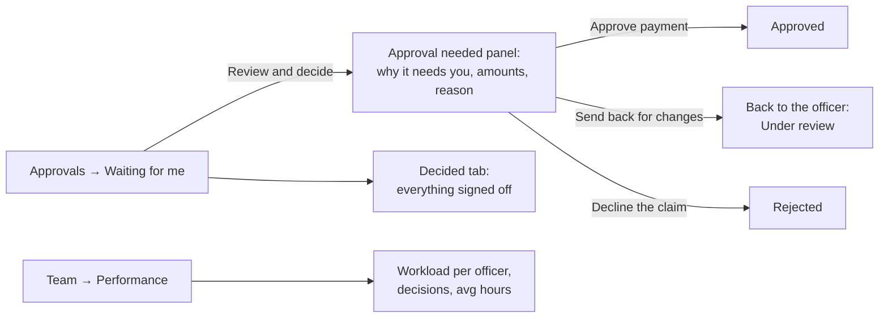
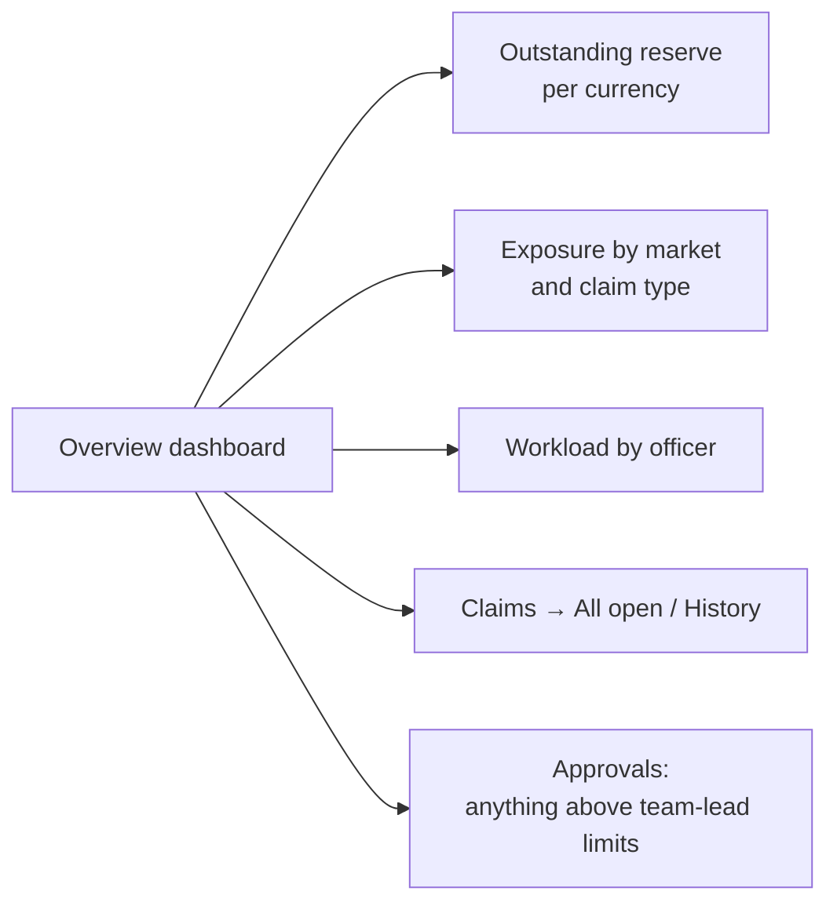

# User flows

How each type of user works in the platform, mapped to the brief. Every flow can be followed in the running app with the demo data. All demo passwords are `password`.

## Who uses it

| User | Role | Position | Reports to | Approves up to (SGD) | Brief |
|---|---|---|---|---|---|
| `claimant1`, `claimant2` | Claimant | — | — | — | *report an incident, track the claim, provide information when asked, receive decisions* |
| `officer1` | Claims staff | Claims Officer, Motor | lead1 | 10,000 | *pick up incoming claims, review and assess, progress to settlement or rejection* |
| `officer2` | Claims staff | Senior Claims Officer, Motor | lead1 | 50,000 | same, with higher authority |
| `officer3` | Claims staff | Claims Officer, Property | lead2 | 10,000 | same |
| `lead1`, `lead2` | Claims staff | Team Lead | manager1 | 250,000 | *see the team's workload and performance*, approve referrals |
| `manager1` | Manager | Claims Manager | — | unlimited | *real-time picture of outstanding claims and liability exposure* |

Limits are per currency (see the README), so no FX conversion is involved.

## The claim lifecycle

Every claim screen shows the status, **who it is waiting on** (claims team, assigned officer, claimant, approver or nobody) and the **next step** in plain language. Buttons appear only when the current user is allowed to take that action.

## End to end, across users

REST is used wherever someone is waiting for an answer. Kafka carries facts that other parts of the system react to: dashboards and claimant notifications. Why: [ADR 0002](adr/0002-rest-vs-kafka.md).

## Claimant

| Step | Screen | What the claimant sees |
|---|---|---|
| Report an incident | **Claims → New claim** | Form with validation; a double click cannot create two claims (`Idempotency-Key`). Optional **supporting documents** (photos, police report, quote). Lands on the new claim's page. |
| Track | **Claims → My claims** | Active claims with status and who they are waiting on. Updates every 10 seconds. |
| Provide information | Banner **We need more information** → claim → **Respond** | The officer's question and an answer box; files go under **Supporting documents** on the same page. |
| Receive the decision | **Claims → History** → claim | Outcome, approved amount and reason, plus the full activity timeline. |

Claimants never see other people's claims (404), staff pages, or internal notes such as the reserve.

## Claims officer

| Step | Screen | Notes |
|---|---|---|
| Pick up work | **Claims → Queue** → claim → **Assign to me** | If two officers click at once, one wins and the other gets a clear conflict message (optimistic locking). |
| Review and assess | **Start review**, **Request info**, **Assess** | Each assessment is kept; the latest sets the reserve that drives exposure. |
| Decide | **Approve** or **Reject** | Above the officer's limit for that currency, approval becomes a referral to someone above them. |
| Settle | **Mark settled** | Releases the reserve from exposure. |
| See own workload | **Claims → Assigned to me**, **Approvals → Sent by me** | |
| See the team | **Team → Performance**, **Team → People** | Open claims by officer and status, decisions, average time to decision. |

Officers see unassigned claims plus their own. They cannot see claims held by colleagues at the same level.

## Team lead

- **Four-eyes:** the person who recommended an amount can never approve it.
- **Reporting line:** a referral can only be reviewed by someone above the recommending officer with enough authority. lead2 cannot see lead1's team's referrals.
- Team leads see their whole reporting line's claims and people, and can also work claims as an officer.

## Manager

Totals are **never summed across currencies**. Dashboards come from the event-fed read model and show **Updated hh:mm:ss**, so it is clear they are near-real-time rather than transactional.

## Demo data: one claim per stage

A fresh stack (`docker compose down -v && docker compose up --build -d`) contains exactly these claims. Each one shows a different part of the flow.

| Claim | Stage | Waiting on | What it shows | Try it as |
|---|---|---|---|---|
| CLM-SG-2026-000001 | Submitted | Claims team | A new motor claim in the queue | `officer1`: Queue → Assign to me |
| CLM-MY-2026-000002 | Submitted | Claims team | A property claim in the queue | `officer3` |
| CLM-PH-2026-000003 | Assigned | officer3 | Picked up, review not started | `officer3`: Start review |
| CLM-SG-2026-000004 | Under review | officer1 | Question asked **and answered**, with the **repair quote and a damage photo** attached; assessed at SGD 6,500, within officer1's limit | `officer1`: Approve SGD 6,500, then Mark settled |
| CLM-TH-2026-000005 | Info requested | Claimant | Officer is waiting for the police report | `claimant2`: banner → Respond |
| CLM-SG-2026-000006 | Pending approval | Approver | officer1 recommended SGD 78,000, above the SGD 10,000 limit, with the **loss adjuster report** attached | `lead1`: Approvals → Waiting for me → Review and decide |
| CLM-HK-2026-000007 | Approved | officer2 | Referral already approved by lead1 (four-eyes complete) | `officer2`: Mark settled; `lead1`: Approvals → Decided |
| CLM-PH-2026-000008 | Rejected | Nobody | Rejection with the policy exclusion as the reason | `claimant2`: History |
| CLM-ID-2026-000009 | Settled | Nobody | Full lifecycle completed | `claimant1`: History → decision |

Together they cover all six markets and every status, and give the manager dashboard open exposure in four currencies.

## Ten-minute walkthrough

1. **Claimant reports.** Sign in as `claimant1` → **New claim** → submit a Singapore motor claim for SGD 30,000. Point out the claim number, status and next step.
2. **Officer picks up.** Sign in as `officer1` → **Queue** → open the new claim → **Assign to me** → **Start review** → **Request info**.
3. **Claimant answers.** As `claimant1`, the **We need more information** banner appears → **Respond**.
4. **Officer assesses and decides above their limit.** As `officer1` → **Assess** SGD 30,000 → **Approve** SGD 30,000 → status becomes **Pending approval**; **Approvals → Sent by me** shows it as Pending.
5. **Team lead approves.** As `lead1` → **Approvals → Waiting for me** → **Review and decide**. The panel explains why it needs sign-off; choose **Approve payment**. Show that `lead2` never sees it.
6. **Officer settles; claimant sees the decision.** `officer1` → **Mark settled**; `claimant1` → **History** → decision card.
7. **Manager sees the effect.** `manager1` → **Overview**: SGD exposure rose at assessment and fell at settlement. Open Kafka UI (http://localhost:8090) to show the events behind it.
